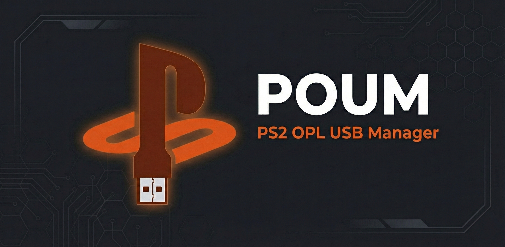
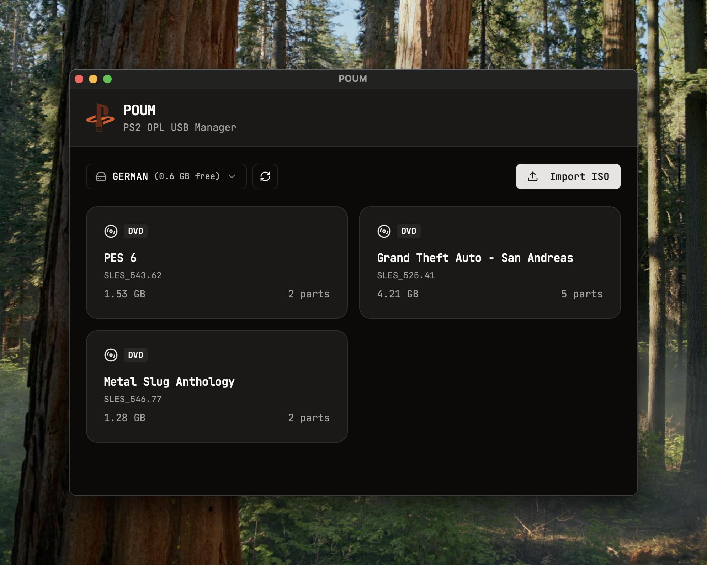
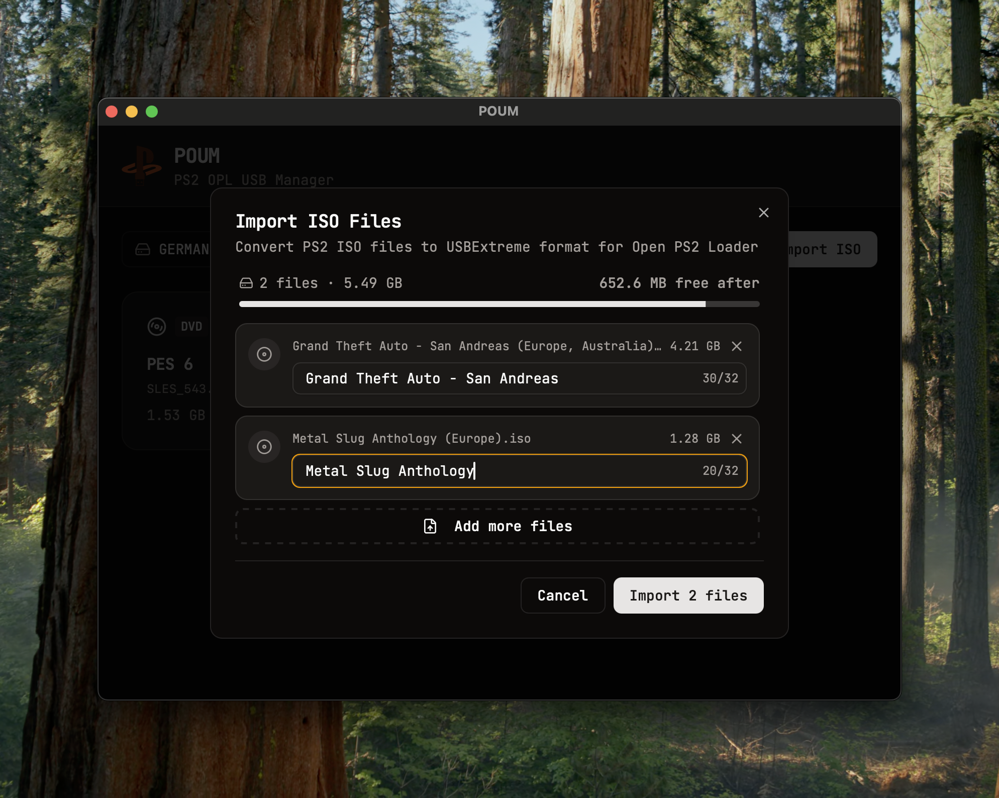

<p align="center">
  
</p>

# POUM

**PS2 OPL USB Manager** - Convert PS2 ISO files to USBExtreme format for Open PS2 Loader.

A desktop application that prepares USB drives for use with [Open PS2 Loader (OPL)](https://github.com/ps2homebrew/Open-PS2-Loader), the popular homebrew app for playing PS2 games from USB storage.

## Features

- **Drive Management**: Detect and initialize USB drives with OPL folder structure
- **ISO Import**: Convert PS2 ISO files to USBExtreme format (ul.* split files)
- **Game Library**: View and manage games on your USB drive
- **Batch Import**: Import multiple ISOs at once with progress tracking
- **Space Validation**: Checks available storage before importing

## Screenshots

<p align="center">
  
</p>
<p align="center"><em>Manage your PS2 game library with an intuitive interface</em></p>

<p align="center">
  
</p>
<p align="center"><em>Batch import ISOs with real-time storage validation</em></p>

## Download

Download the latest release for your platform from the [Releases](https://github.com/germancastro/poum/releases) page.

## Usage

1. **Connect a USB drive** formatted as FAT32
2. **Select your drive** from the dropdown
3. **Initialize** the drive (creates OPL folder structure if needed)
4. **Import ISOs** using the Import button
5. **Eject** and use with your PS2 + OPL setup

## Development Setup

### Prerequisites

- [Node.js](https://nodejs.org/) (v18+)
- [Rust](https://rustup.rs/) (latest stable)
- [Bun](https://bun.sh/) (optional, npm works too)

### Install Dependencies

```bash
bun install
```

### Run in Development

```bash
bun run tauri dev
```

### Build for Production

```bash
bun run tauri build
```

The built application will be in `src-tauri/target/release/bundle/`.

## Tech Stack

- **Frontend**: React + TypeScript + Tailwind CSS + shadcn/ui
- **Backend**: Rust + Tauri v2
- **Build**: Vite

## License

MIT
